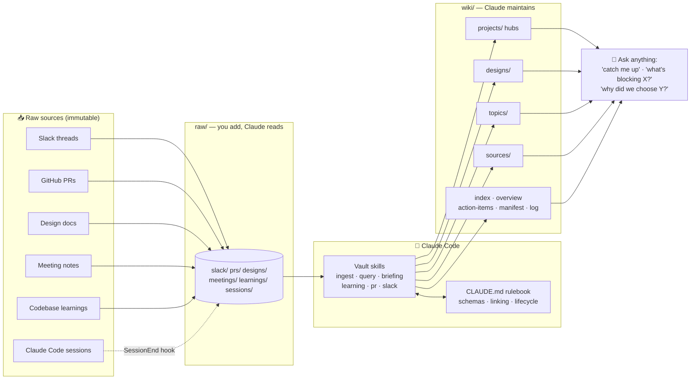

# Claude Code Vault — an LLM Wiki second brain

A drop-in **personal knowledge base** for [Claude Code](https://docs.claude.com/en/docs/claude-code). You feed it raw sources — Slack threads, PRs, design docs, meeting notes, and your own coding sessions — and Claude processes them into a structured, cross-linked wiki you can query, get briefings from, and grow over time.

It's built on one idea: **let Claude maintain a wiki for you.** Raw inputs are immutable; Claude reads them and writes clean, interlinked pages (projects, designs, topics, sources) with frontmatter, backlinks, action-item tracking, and staleness detection — all driven by a set of skills and a `CLAUDE.md` rulebook.

Works great with [Obsidian](https://obsidian.md) pointed at the same folder (the wiki uses `[[wiki-links]]`), but Obsidian is optional.

## The idea in one picture



**The flow:**
1. **Sources land in `raw/`** — you paste a Slack/PR link, drop a design doc, or a Claude session ends (a hook auto-captures it).
2. **You say "ingest"** (or ask a question). A vault skill kicks in and follows the `CLAUDE.md` rulebook.
3. **Claude writes the wiki** — creates/updates source summaries, project hubs, topic pages, and design docs; extracts action items; keeps an index, manifest, and log; and cross-links everything with `[[wiki-links]]`.
4. **You query it** — "catch me up on project X", "what's blocking Y?", "why did we choose Z?" Claude reads the wiki and answers with citations.

## What's in the box

| Piece | What it does |
|-------|--------------|
| **6 skills** | `vault-ingest`, `vault-query`, `vault-briefing`, `vault-learning`, `vault-pr-ingest`, `vault-slack-ingest` |
| **`CLAUDE.md`** | The rulebook Claude follows inside the vault: page schemas, ingest workflow, linking rules, action-item lifecycle, staleness/lint rules |
| **`raw/` + `wiki/`** | The vault folders — pre-seeded and ready |
| **`templates/`** | Page templates for each wiki page type |
| **Session hooks** | Auto-capture a summary of every Claude Code session into `raw/sessions/` |
| **`install.sh`** | One command to wire it all into `~/.claude/` |

## Install

**Prerequisites:** [Claude Code](https://docs.claude.com/en/docs/claude-code) and `jq`. For PR ingest you'll want the `gh` CLI authenticated; for Slack ingest, a Slack MCP server connected.

```bash
git clone https://github.com/rushabhvaria/vault.git
cd vault
./install.sh
```

The installer:
- Uses **this cloned directory as your live vault** (your `raw/` and `wiki/` live here).
- Installs the six skills into `~/.claude/skills/` with the vault path baked in.
- Installs resolved session hooks into `~/.claude/hooks/vault/`.
- Registers the `SessionEnd` hook in `~/.claude/settings.json` (backs up the original first; safe to re-run).

Skills only, no session capture:

```bash
./install.sh --skills-only
```

> **Keep your notes private:** this repo is your vault. Point it at a **private** repo (or don't push it) so your `raw/` and `wiki/` content stays private. See [`docs/SETUP.md`](docs/SETUP.md) for the recommended "public template, private vault" split.

## Use it

Once installed, in any Claude Code session:

- **Ingest** — drop a file into `raw/` and say `ingest`, or paste a link:
  - `track this PR https://github.com/org/repo/pull/123`
  - `ingest this slack thread <link>`
  - `save this learning` (captures an insight from the current chat)
- **Query** — `why did we pick Postgres over Dynamo?` · `what PRs are open for project X?`
- **Briefing** — `catch me up` (morning briefing) · `briefing on project X`
- **Maintain** — `lint the vault` (finds stale pages, broken links, orphans, overdue items)

Sessions auto-capture on exit. To backfill past sessions once:

```bash
~/.claude/hooks/vault/backfill-sessions.sh
```

## How it stays organized

- **`raw/` is immutable** — Claude never edits your inputs, only reads them.
- **Every source is tracked** in `wiki/manifest.md`; every change is logged in `wiki/log.md`.
- **Everything cross-links** with `[[wiki-links]]` (Obsidian-friendly, backlinks resolve automatically).
- **Idempotent** — re-ingesting a source updates existing pages instead of duplicating.
- **Frontmatter-typed** — every page validates against a schema; `lint` catches drift.

See [`docs/SETUP.md`](docs/SETUP.md) for details and [`docs/ARCHITECTURE.md`](docs/ARCHITECTURE.md) for the full page-type reference. The authoritative rulebook Claude follows is [`CLAUDE.md`](CLAUDE.md).

## Repo layout

```
vault/
├── CLAUDE.md            # rulebook Claude follows inside the vault
├── install.sh           # installer
├── skills/              # the 6 vault skills (installed into ~/.claude/skills)
├── hooks/               # session-capture hooks (installed into ~/.claude/hooks/vault)
├── templates/           # wiki page templates
├── raw/                 # YOUR inputs go here (seeded, empty)
├── wiki/                # Claude maintains this (seeded index/overview/etc.)
└── docs/                # SETUP + ARCHITECTURE
```

## Uninstall

- Remove the `vault-*` folders from `~/.claude/skills/`.
- Remove `~/.claude/hooks/vault/`.
- Remove the SessionEnd entry pointing at `hooks/vault/session-capture.sh` from `~/.claude/settings.json` (restore a `.bak` the installer left).
